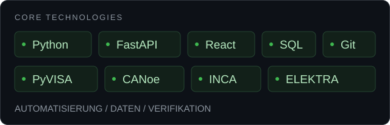

  <a href="#ausgewählte-projekte">Projekte</a> &nbsp; / &nbsp;
  <a href="#technologien">Technologien</a> &nbsp; / &nbsp;
  <a href="#hintergrund">Hintergrund</a>

### Vom Messsignal zur Software.

Ich entwickle Python-Lösungen für **Messautomatisierung, Test und Verifikation**. Meine Erfahrung aus der Automobilindustrie verbinde ich mit APIs, Datenanalyse und webbasierten Anwendungen.

 

## Technologien

Weitere Engineering-Werkzeuge

MATLAB · LTspice · ANSYS · CATIA V5 · Oszilloskope · Signalverarbeitung

## Ausgewählte Projekte

Fullstack-Projekt mit **React, FastAPI und SQL**. Messungen auslösen, Oszilloskop-Screenshots speichern und die Messhistorie abrufen. Mit Mock-Modus für den Einstieg ohne Hardware.

**Python-basierte ESD-Prüfabläufe** mit Oszilloskop-Anbindung, Pulsanalyse und PASS/FAIL-Bewertung. Strukturierte Messdaten und Screenshots unterstützen die automatische Berichtserstellung.

Python-Skripte zur Unterstützung **automatisierter Verifikationsabläufe** und zur Auswertung von Messergebnissen.

[Alle Repositories ansehen ↗](https://github.com/ottopower2?tab=repositories)

## Hintergrund

**Seit 2021 · EMV-Ingenieur bei CSA Group im BMW-Entwicklungsumfeld**  
EMV-Qualifikation von Hochvoltkomponenten, Python-basierte Messautomatisierung, Pulsverifikation und technische Dokumentation.

<strong>Berufserfahrung & Ausbildung</strong>

- **09/2021–heute · CSA Group, München:** EMV-Ingenieur im BMW-Entwicklungsumfeld.
- **07/2019–06/2021 · über ep Engineering für Continental Services Engineering:** Package- und Einbauuntersuchungen mit Schwerpunkt elektrischer Antriebsstrang.
- **04/2018–05/2019 · über MCA Engineering für TESCA Group:** Entwicklung passiver Sicherheitssysteme.
- **2017–2018 · Knorr-Bremse:** Werkstudent, Schwingungsversuche und FEM-Analysen.
- **2015–2017 · Master of Engineering:** Energietechnik.
- **2011–2015 · Bachelor of Engineering:** Maschinenbau.
- **Zusatzqualifikation:** BMW Hochvolt-Qualifikation (HV2).

<strong>Sprachen & Interessen</strong>

Deutsch – sehr gut · Englisch – C1 · Französisch – verhandlungssicher · Arabisch – Muttersprache.

Künstliche Intelligenz · Softwareentwicklung · Elektromobilität · Elektronik.

---

<strong>Python · Softwaretest · Automatisierung · Messtechnik</strong> Präzise messen. Verständlich auswerten. Mit Software weiterdenken.

