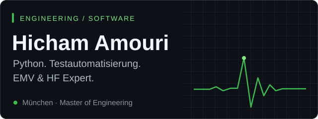
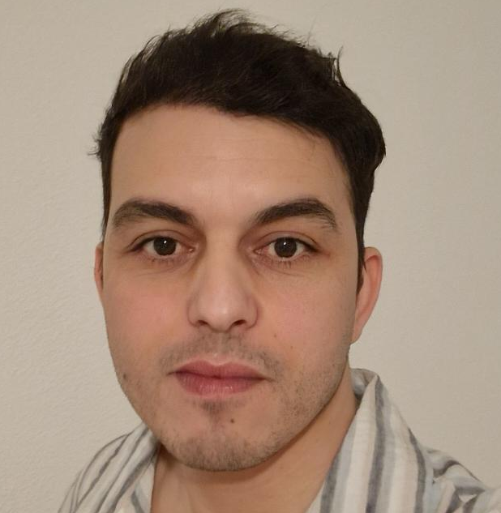
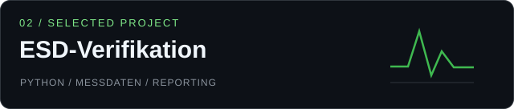

 

---

## 🧠 Über mich

<!--  -->

**Vom Messsignal zur Software.**

Ich entwickle Python-Lösungen für **Messautomatisierung, Test und Verifikation**. Meine Erfahrung aus der Automobilindustrie verbinde ich mit APIs, Datenanalyse und webbasierten Anwendungen.

 

---

## 🎯 Aktueller Fokus

Seit 2021 arbeite ich als **EMV-Ingenieur bei CSA Group im BMW-Entwicklungsumfeld**, mit Schwerpunkt auf:

- ⚡ **EMV-Qualifikation von Hochvoltkomponenten**
- 🤖 **Python-basierte Messautomatisierung**
- 📈 **Pulsverifikation & Datenanalyse**
- 🌐 **Webbasierte Mess- und Auswerteplattformen (FastAPI/React/SQL)**
- 📝 **Technische Dokumentation & Berichtserstellung**

---

## 🛠️ Tech-Stack

### Sprachen & Kernengineering

### Frontend & Backend

### Mess- & Prüftechnik

Weitere Engineering-Werkzeuge

 

---

## 🌍 Sprachen

- 🇩🇪 **Deutsch** — sehr gut
- 🇬🇧 **Englisch** — C1
- 🇫🇷 **Französisch** — verhandlungssicher
- 🇸🇦 **Arabisch** — Muttersprache

---

## ✨ Arbeitsweise

- 🔬 Präzise und messdatengetrieben
- 🧩 Denke von Hardware zu Software
- 📊 Strukturierte Auswertung statt Bauchgefühl
- 🚗 10+ Jahre Automotive-/EMV-Erfahrung
- 💡 Interesse an KI, Elektromobilität und Elektronik

---

## 🚀 Ausgewählte Projekte

Fullstack-Projekt mit **React, FastAPI und SQL**. Messungen auslösen, Oszilloskop-Screenshots speichern und die Messhistorie abrufen. Mit Mock-Modus für den Einstieg ohne Hardware.

**Python-basierte ESD-Prüfabläufe** mit Oszilloskop-Anbindung, Pulsanalyse und PASS/FAIL-Bewertung. Strukturierte Messdaten und Screenshots unterstützen die automatische Berichtserstellung.

Python-Skripte zur Unterstützung **automatisierter Verifikationsabläufe** und zur Auswertung von Messergebnissen.

[Alle Repositories ansehen ↗](https://github.com/ottopower2?tab=repositories)

---

## 📊 GitHub Stats

  

---

## 🧩 Werdegang

**Seit 2021 · EMV-Ingenieur bei CSA Group im BMW-Entwicklungsumfeld**
EMV-Qualifikation von Hochvoltkomponenten, Python-basierte Messautomatisierung, Pulsverifikation und technische Dokumentation.

<strong>Berufserfahrung & Ausbildung</strong>

- **09/2021–heute · CSA Group, München:** EMV-Ingenieur im BMW-Entwicklungsumfeld.
- **07/2019–06/2021 · über ep Engineering für Continental Services Engineering:** Package- und Einbauuntersuchungen mit Schwerpunkt elektrischer Antriebsstrang.
- **04/2018–05/2019 · über MCA Engineering für TESCA Group:** Entwicklung passiver Sicherheitssysteme.
- **2017–2018 · Knorr-Bremse:** Werkstudent, Schwingungsversuche und FEM-Analysen.
- **2015–2017 · Master of Engineering:** Energietechnik.
- **2011–2015 · Bachelor of Engineering:** Maschinenbau.
- **Zusatzqualifikation:** BMW Hochvolt-Qualifikation (HV2).

---

## 🤝 Let's Connect

- 🧑‍💻 GitHub: [ottopower2](https://github.com/ottopower2)

---

<strong>Python · Softwaretest · Automatisierung · Messtechnik</strong> Präzise messen. Verständlich auswerten. Mit Software weiterdenken.

