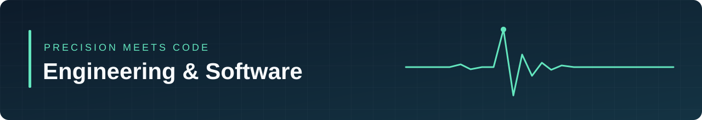

  

  

<h1 align="center">Hicham Amouri</h1>

<strong>Python · Testautomatisierung · EMV_HF Expert</strong>

München, Deutschland · Master of Engineering, Energietechnik

  <a href="https://github.com/ottopower2">Kontakt</a> ·
  <a href="#ausgewählte-projekte">Projekte</a> ·
  <a href="#beruflicher-hintergrund">Erfahrung</a>

---

## Über mich

Ich verbinde Engineering-Erfahrung aus der Automobilindustrie mit Python-Entwicklung und automatisierten Prüfabläufen. Mein Schwerpunkt liegt auf **Messautomatisierung, Test und Verifikation sowie der strukturierten Auswertung von Messdaten**.

Aus der praktischen Arbeit mit EMV-Prüfungen und elektrischen Systemen weiß ich, wie wichtig nachvollziehbare Ergebnisse sind. Mit Software unterstütze ich den Weg vom Messgerät über die Auswertung bis zur technischen Dokumentation. Ergänzend entwickle ich webbasierte Anwendungen mit FastAPI, React und SQL.

## Was ich einbringe

- **Automatisierung:** Python-Skripte für Messgeräteansteuerung, Datenerfassung und wiederholbare Prüfabläufe.
- **Test & Verifikation:** Testfallimplementierung, Pulsanalyse, Fehleranalyse und Dokumentation von Prüfergebnissen.
- **Software & Daten:** REST-APIs, Datenbankanbindung und Visualisierung zum Vergleichen von Messkurven und Prüfläufen.
- **Engineering:** Erfahrung mit EMV-Qualifikation, Hochvoltsystemen und der technischen Abstimmung im Automotive-Umfeld.

## Ausgewählte Projekte

### 01 · ESD-Messplattform

**Fullstack-Lernprojekt für Messabläufe und Messhistorie**

Eine webbasierte Anwendung, die Messgeräteanbindung, API und Datenbank zusammenführt. Messungen lassen sich auslösen, mit einem Oszilloskop-Screenshot speichern und über eine Messhistorie abrufen. Ein Mock-Modus ermöglicht den Einstieg ohne angeschlossenes Messgerät.

`Python` `FastAPI` `React` `SQL` `SCPI / VISA`

[Repository ansehen →](https://github.com/ottopower2/esd_measurement_project_react_sql)

### 02 · ESD-Verifikation

**Von der Messkurve zur dokumentierten Bewertung**

Python-basierte Unterstützung für ESD-Prüfungen mit Oszilloskop-Anbindung, Auswertung von Pulsparametern und PASS/FAIL-Bewertung. Screenshots und strukturierte Messdaten bilden die Grundlage für automatisch erzeugte Prüfberichte.

`Python` `PyVISA` `Messdatenanalyse` `Reporting`

[Repository ansehen →](https://github.com/ottopower2/ESD)

### 03 · TSUP-Verifikation

**Python-Skripte für Verifikationsabläufe**

Unterstützung automatisierter Verifikationsabläufe und der Auswertung von Messergebnissen. Das Projekt verbindet Python-Entwicklung mit meinem fachlichen Schwerpunkt in der elektrischen Messtechnik.

`Python` `Verifikation` `Messtechnik`

[Repository ansehen →](https://github.com/ottopower2/TSUP)

## Technologien & Werkzeuge

**Softwareentwicklung**  
Python · OOP · FastAPI · REST-APIs · React · SQL · Git / GitHub

**Test, Messung & Analyse**  
Messautomatisierung · Signalverarbeitung · Oszilloskope · Rohde & Schwarz ELEKTRA · CANoe · ETAS INCA

**Engineering & Simulation**  
MATLAB · LTspice · ANSYS · CATIA V5

## Beruflicher Hintergrund

**Seit 09/2021 · EMV-Ingenieur | CSA Group, im BMW-Entwicklungsumfeld, München**  
EMV-Qualifikation von Komponenten für Hochvoltsysteme und elektrische Antriebe. Entwicklung von Python-Skripten für Mess- und Prüfabläufe, Pulsverifikation, Messdatenauswertung und technische Dokumentation.

**07/2019–06/2021 · Entwicklungsingenieur | über ep Engineering für Continental Services Engineering**  
Package- und Einbauuntersuchungen für Gesamtfahrzeuge mit Schwerpunkt elektrischer Antriebsstrang.

**04/2018–05/2019 · Entwicklungsingenieur | über MCA Engineering für TESCA Group**  
Konstruktion und Entwicklung im Bereich passiver Sicherheitssysteme für Fahrzeugprojekte.

<strong>Studium, weitere Erfahrung & Sprachen</strong>

- **Master of Engineering, Energietechnik** · 2015–2017
- **Bachelor of Engineering, Maschinenbau** · 2011–2015
- **Werkstudent bei Knorr-Bremse** · 2017–2018: Auswertung von Schwingungsversuchen und FEM-Analysen.
- **Zusatzqualifikation:** BMW Hochvolt-Qualifikation (HV2).
- **Sprachen:** Deutsch – sehr gut · Englisch – C1 · Französisch – verhandlungssicher · Arabisch – Muttersprache.

## Austausch & Kontakt

Ich interessiere mich für den Austausch zu **Python-Entwicklung, Softwaretest, Testautomatisierung und Messtechnik**.

[Auf GitHub verbinden](https://github.com/ottopower2) · [Alle öffentlichen Repositories](https://github.com/ottopower2?tab=repositories)

Präzise messen. Verständlich auswerten. Mit Software weiterdenken.

